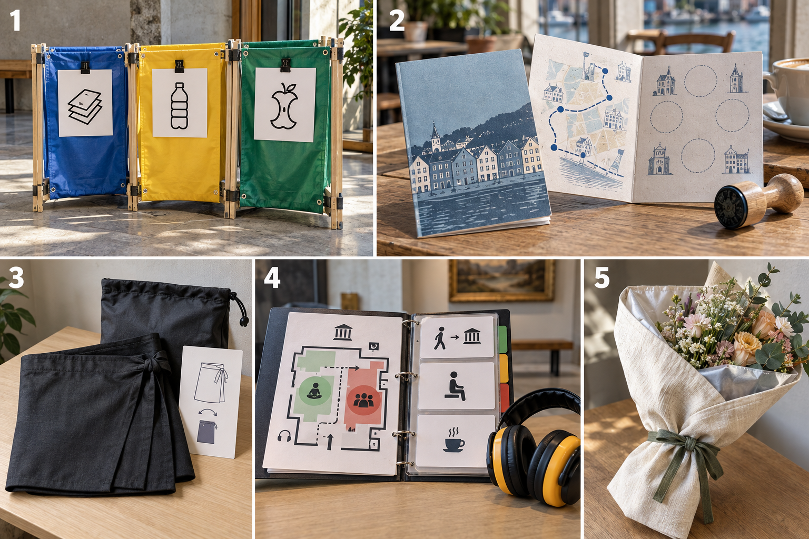

# Fem nye idékandidater

Dato: 14.10.2026. Bestilling: finn fem nye ideer over 28 poeng, kartlegg konkurrenter og vis mulige prototyper.

Bildet er laget med KI 14.10.2026. Det viser **konsepter**, ikke prototyper teamet har bygget eller testet. Bildenummer følger rekkefølgen under.

## Kort svar

Alle fem når minst 28 av 40 i en **foreløpig, subjektiv** vurdering mot de åtte spørsmålene i `skills/ungdomsbedrift-vestland/SKILL.md` kapittel 1.2. Ingen har dokumentert kunde, betalende pilot eller egen produksjonskostnad. Poengene er derfor ikke bevis på at ideene kan vinne. Beste første test er sorteringsskilt på et skolearrangement og et bydelspass hos én aktør på Nordnes. Idéen er fortsatt ikke valgt.

Konkurransekriteriene for Vestland 2027 publiseres ifølge [UE Vestland](https://www.ue.no/vestland/info/fylkesmesterskap-ungdomsbedrift) i begynnelsen av november 2026. Poeng for kategoritilpasning bygger på tidligere kriterier og må kontrolleres da.

## Slik ble ideene vurdert

Kolonnene P, Pr, B, K, Pa, Ko, S og Kat er rubrikkens punkter: dokumenterbart problem, prototype, tre bærekraftsdimensjoner, betalende kunde, partner, lav produksjonskostnad, skalerbarhet og minst fire kategorier. Hvert punkt får 1 til 5. Tallene er vurderinger gjort 14.10.2026, ikke målte resultater.

| Bilde | Ny idé | P | Pr | B | K | Pa | Ko | S | Kat | Sum |
|---|---|---:|---:|---:|---:|---:|---:|---:|---:|---:|
| 1 | Modulære sorteringsskilt til små arrangementer | 4 | 5 | 4 | 3 | 4 | 4 | 4 | 5 | **33** |
| 2 | Bydelspass for Nordnes | 4 | 5 | 4 | 3 | 4 | 5 | 4 | 4 | **33** |
| 3 | Anonymt låneplagg etter menslekkasje | 4 | 5 | 3 | 2 | 4 | 5 | 4 | 4 | **31** |
| 4 | Sansemappe for besøkssteder | 4 | 5 | 2 | 2 | 3 | 5 | 4 | 3 | **28** |
| 5 | Ombrukbar bukettmansjett | 3 | 5 | 3 | 2 | 5 | 4 | 4 | 4 | **30** |

### 1. Modulære sorteringsskilt til små arrangementer, 33/40

**Produkt og kunde:** En utleiepakke med stativ av tre, trekk av kassert bannerduk og utskiftbare piktogrammer for avfallstypene på akkurat dette arrangementet. Kunden er et idrettslag, en skole eller en liten arrangør. Bergen kommune ber arrangører merke avfallsbeholdere tydelig, lage en tilpasset sorteringsguide og spare bannere til gjenbruk. [Bergen kommune, avfallsveileder, oppdatert 05.11.2025](https://www.bergen.kommune.no/innbyggerhjelpen/kultur-idrett-og-fritid/utlan-og-leie/byrom/avfallsveileder-for-arrangementer-i-bergen).

**Konkurrenter:** [Markedsmateriell](https://www.markedsmateriell.no/arenaer/festival) selger informasjonsskilt til festivaler. [Exposhop](https://www.exposhop.no/profilering-av-vegger-banner) tilbyr bannerrammer. Gratis utskrift på papir er den vanskeligste konkurrenten. Offentlige priser for en sammenlignbar utleiepakke er ikke funnet. Vår mulige forskjell er ferdig sorteringsoppsett, leie og gjenbruk av samme pakke på nye arrangementer. Markedsmateriell har profesjonell kvalitet og montering som vi ikke har.

**Første test:** Lag én stasjon, få tillatelse fra én arrangør, tell feilsorterte gjenstander før og etter tydelig merking, og be om et skriftlig tilbud eller betalt pilot. Råvare fra skiltfirma er ennå ikke avtalt. Bruk ikke løsningen som sikkerhets- eller trafikkskilt. Hvis arrangører foretrekker å skrive ut selv, faller kundepoeng og idéen.

### 2. Bydelspass for Nordnes, 33/40

**Produkt og kunde:** Et lite regntålig papirhefte med selvguidet rute og stempler hos lokale butikker eller kaféer. Et hotell, en lokal næringsforening eller turisten kan betale. Målet er å lede besøkende til steder utenfor Bryggen og gi omsetning til lokale aktører. I Visit Bergens undersøkelse gjennomført i uke 35 og 36 i 2025 med 1210 innbyggere svarte 50 prosent at det er for mange turister i Bergen. 39 prosent av dem som ble spurt om overfylte steder nevnte Bryggen først. Dette dokumenterer opplevd press, ikke at et pass vil flytte folk. [Opinion for Visit Bergen, 2025](https://www.visitbergen.com/dbimgs/Innbyggerundersokelse-Bergen-2025.pdf).

**Konkurrenter:** [Historic Nordnes](https://en.visitbergen.com/things-to-do/historic-nordnes-merchants-witches-crime-and-hidden-alleys-p6209503) har guidet tur fra 310 kr, lest 14.10.2026. [Visit Bergen](https://en.visitbergen.com/ideas-and-inspiration/explore-bergen/districts-and-neighborhoods-in-bergen-city-center) har gratis bydelsguider. [Let's Roam](https://www.letsroam.com/scavenger-hunt/bergen-norway) har en appstyrt Bergen-jakt. Vår mulige forskjell er fysisk pass og handel hos konkrete Nordnes-aktører. Guidede turer gir mer faglig formidling enn vårt hefte.

**Første test:** Få tre stempelsteder og én betalende vert, trykk noen få hefter, registrer hvor mange som fullfører ruten og spør hva de ellers ville gjort. Oppgi kulturhistoriske fakta med kilder. Uten partner og brukstall er påstanden om mindre trengsel bare en hypotese. Sjekk tillatelse til navn og logoer.

### 3. Anonymt låneplagg etter menslekkasje, 31/40

**Produkt og kunde:** Mørke omslagsskjørt eller vide bukser av kontrollerte brukte tekstiler, i anonym pose hos helsesykepleier. Skolen eller fylket må betale for en utlånsordning. Produktet håndterer synlig lekkasje etter at et bind ikke lenger løser hele situasjonen. En leverandørfinansiert Kantar/Sifo-undersøkelse gjennomført i februar 2024 intervjuet 450 jenter mellom 13 og 18 år om mensen på skolen. Nettstedet har motstridende prosenttall, så vi bruker ikke disse. [Mensen på skolen, undersøkelsesbeskrivelse, lest 14.10.2026](https://www.mensenpaskolen.no/). Problemet **synlig lekkasje spesielt** er ikke tallfestet her.

**Konkurrenter:** [Scarlet by RedDrop](https://tryreddrop.com/pages/schools-camps) selger mensenprodukter til skoler. [WUKA](https://wukawear.no/collections/period-school-set) selger skolesett med menstruser, 327 kr for to par på siden lest 14.10.2026. [Herbox via Krisko](https://www.krisko.no/products/dispenser-resirk-for-tamponger-bind-hvit) tilbyr dispenser. Disse forebygger eller håndterer mensen, men et nøytralt låneplagg kan dekke behovet når klær allerede er tilsølt. De etablerte aktørene har ferdige hygieneløsninger som vi mangler.

**Første test:** Spør helsesykepleier og elevråd om behov og rutine, finn skolens kjøpsbeslutning, lag ett plagg og dokumenter vask, oppbevaring og retur. Ikke lag personlige utlånslogger. Uten skole som kunde faller idéen under terskelen.

### 4. Sansemappe for besøkssteder, 28/40

**Produkt og kunde:** En fysisk mappe med sansekart, enkle ankomstkort og pausekort for én attraksjon i Bergen. Attraksjonen betaler for kartlegging og materiell. [Autismeforeningen](https://autismeforeningen.no/hva-er-autisme/fatt-diagnose/) beskriver sansefølsomhet, og [Bufdir](https://www.bufdir.no/statistikk-og-analyse/funksjonsnedsettelse/lokalsamfunn-kultur-fritid-idrett/) har statistikk om deltakelse i kultur og fritid. Dette er grunnlag for å undersøke behov, ikke en måling ved det aktuelle besøksstedet.

**Konkurrenter:** [Norsk Teknisk Museum](https://www.tekniskmuseum.no/museet/sensoriske-tilbud?lang=nb-NO) tilbyr allerede sansekart, sosial historie, visuell sjekkliste og hørselvern. [Met Museum](https://www.metmuseum.org/events/programs/access/visitors-with-developmental-and-learning-disabilities/for-visitors-with-autism-spectrum-disorders) har sosial historie. [VilVite](https://en.visitbergen.com/things-to-do/bergen-science-centre-vilvite-p817823) må undersøkes som mulig lokal partner og eksisterende alternativ. Vi kan levere lokalt, men har ingen dokumentert faglig fordel over museene.

**Første test:** Få én attraksjon og brukere med ulike behov til å kartlegge lokalene sammen. Test mappen med samtykke, mål om den faktisk gjør besøket lettere, og avklar betaling. Be fagpersoner kontrollere symboler og språk. Uten dette er 28 poeng for høyt, særlig på kunde, partner og kategorier.

### 5. Ombrukbar bukettmansjett, 30/40

**Produkt og kunde:** Justerbar tekstilinnpakning for bukett, sydd av rene kasserte hotelltekstiler, med tørr barriere mot stilkene. En blomsterbutikk selger den som tillegg eller prøver returordning. [Mester Grønn, bærekraftsrapport 2024](https://www.mestergronn.no/on/demandware.static/-/Sites-mg-Library/default/dw7fcace17/images/MesterGronn/Barekraftsrapport%202024.pdf) beskriver overgang fra cellofan til kraftpapir og har allerede gjenbruksseil i transport. At vårt tekstil er bedre for miljøet er **ikke dokumentert** før faktisk ombruk og vask måles.

**Konkurrenter:** Mester Grønns kraftpapir er et enkelt alternativ. [Floristik24](https://www.floristik24.no/mansjettpapir-blomsterpapir-silkepapir-rosa-25cm-100m_no_4853) selger blomsterpapir. [Unikum Design](https://www.unikumdesign.no/produkt/hus-hjem/nyhet-gaveinnpakning-bursdagsblomster-unikum-1) selger gjenbrukbar tekstilinnpakning av stoffrester for 89 kr på siden lest 14.10.2026. Forskjellen må bli bukettpassform, lokal innsamling og dokumentert retur, ikke bare gjenbrukstekstil. Unikum har allerede et ferdig produkt og offentlig pris.

**Første test:** Sy to størrelser, test fukt og fargesmitte, få en florist til å tilby den til faktiske kunder og registrer salg og retur. Kasser idéen hvis floristen ikke får betalt mer enn for kraftpapir eller mottakeren ikke bruker mansjetten igjen.

## Hva vi faktisk gjennomgikk

Prosjektets [18 eksisterende ideer](../bedrift/06-idekandidater.md) og tilhørende research ble gjennomgått før søket. Restefrukt, oljeabsorbent, fuglekrage og låneparaply er allerede kandidater, så de er ikke telt som nye. Fem nye spor ble undersøkt på tvers av offisielle kilder, lokale bransjesider, produsenter og konkurrenter. Samtalekort for nye elever ble forkastet fordi [UiO allerede har gratis fysisk språkspill](https://www.uv.uio.no/ils/forskning/prosjekter/snakkomspraak/index.html). Regnpose for våte klær ble forkastet fra topp fem på grunn av svak dokumentasjon for betalingsvilje og etablerte våtposer. Ingen søkeprosess kan bevise at ingen andre har samme idé.

## Neste beslutning

Velg to konsepter å teste først. Snakk med ti i målgruppen og to mulige betalere **per konsept**, noter svarene ordrett og datert i bevisboka. Bygg en virkelig prototype, mål pris og kostnad, og regn poengene på nytt. Ikke lås bedriftsidéen på denne rapporten alene.

## Metode og kildegrense

Research utført 14.10.2026 med søk, gjennomlesing av prosjektets tidligere research og direkte lesing av kildesider. Offentlige kilder er brukt for problemet og regelkontekst, produsenters egne sider for konkurrentenes tilbud. Kildebelagte eksterne tall er knyttet til kilde og år over. Priser er øyeblikksbilder lest 14.10.2026 og kan endres. Ingen egne kundeintervjuer, avtaler, salg eller materialtester ble utført. Bildet ble generert med innebygd bildegenerator fra en tekstbeskrivelse av fem håndlagde konseptprototyper.
