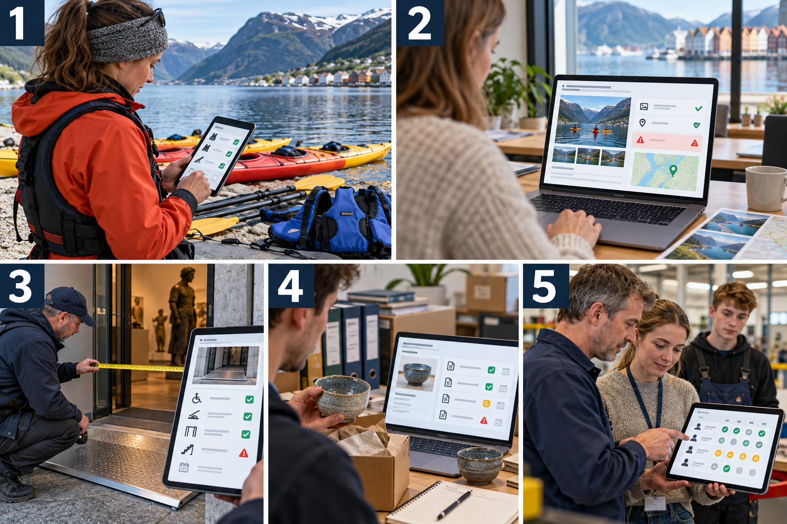

# Større problemer med mulig SaaS-modell

Dato: 14.10.2026. Spørsmål: Finn sterkere UB-ideer enn de fem små produktene i `2026-10-14-fem-nye-ideer.md`. Prioriter alvorlig problem, gjentatt arbeidsflyt, identifiserbar kjøper og mulighet for en faktisk pilot før fylkesmesterskapet.

Bildet er laget med KI 14.10.2026. Det viser tenkte grensesnitt og situasjoner, ikke programvare eller pilot teamet har bygget. Tallene i bildet følger rekkefølgen under.

## Kort svar

**TurSjekk** og **Salgsklar** bør undersøkes først. De har dokumenterte, gjentatte B2B-problemer og en første kunde som kan kontaktes lokalt. **Tilgjengelighetslogg** har større sosial betydning, men betalingsviljen er usikker. **ImportBevis** og **YFF-kontakt** er betingede spor: sterke problemer, men tunge konkurrenter eller vanskelig kjøpsprosess. Ingen av ideene har kundeintervju, betalt pilot eller bygget SaaS. Ikke velg idé ut fra poengene alene.

De fem ideene fra den forrige undersøkelsen står i idébanken som historikk, men er ikke lenger anbefalt som hovedspor etter teamets tilbakemelding 14.10.2026. Den forrige vurderingen vektla en lett fysisk prototype for høyt og problemets størrelse og betalingsflyt for lite. Det er en feil i prioriteringen, ikke nye fakta om markedet.

## Foreløpig rubrikk

P = dokumenterbart problem, Pr = praktisk prototype eller pilot, B = sosial, miljømessig og økonomisk bærekraft, K = betalende kunde, Pa = partner, Ko = lav kostnad for første enhet, S = skalerbarhet, Kat = minst fire kategorier. Hvert punkt får 1 til 5 etter `skills/ungdomsbedrift-vestland/SKILL.md` kapittel 1.2. **Alle poeng er subjektive vurderinger gjort 14.10.2026.** Særlig K og Kat kan falle etter intervjuer og når Vestland publiserer 2027-kriteriene.

| Bilde | Idé | P | Pr | B | K | Pa | Ko | S | Kat | Sum |
|---|---|---:|---:|---:|---:|---:|---:|---:|---:|
| 1 | TurSjekk | 5 | 4 | 3 | 3 | 4 | 5 | 4 | 4 | **32** |
| 2 | Salgsklar | 4 | 4 | 3 | 3 | 4 | 5 | 4 | 4 | **31** |
| 3 | Tilgjengelighetslogg | 4 | 4 | 4 | 2 | 4 | 5 | 4 | 3 | **30** |
| 4 | ImportBevis | 4 | 4 | 3 | 2 | 3 | 5 | 4 | 3 | **28** |
| 5 | YFF-kontakt | 5 | 4 | 4 | 1 | 4 | 4 | 3 | 4 | **29** |

Poengene sier at ideene fortjener en test. De sier ikke at fem SaaS-bedrifter er levedyktige. Manglende salg kan senke alle under 28.

## 1. TurSjekk, 32/40

**Problem og kjøper.** Små tilbydere av kajakk-, rafting- og andre risikofylte turer må vurdere vær, deltakere og utstyr løpende og følge opp hendelser. [DSB beskriver dette ansvaret for rafting](https://www.dsb.no/produkter-og-forbrukertjenester/forbrukertjenester/rafting/), lest 14.10.2026. Sikkerhetsansvaret blir hos operatøren også når den bruker en ekstern tjeneste. Kjøperen kan være eieren eller driftssjefen hos en lokal aktivitetsoperatør.

**Tjeneste, så SaaS.** Start med å kartlegge én konkret avgangsrutine sammen med operatøren. Første programvareversjon viser en mobil avgangssjekk, navngitt ansvarlig, feil på utstyr og oppfølging etter tur. Den skal registrere vurderinger gjort av kvalifiserte guider, ikke automatisk erklære en tur trygg. Gjentatt abonnement per operatør eller sesong er en **prishypotese**, ikke dokumentert betalingsvilje.

**Konkurrenter.** [HMS Nova](https://www.hmsnova.no/bransjer/aktivitet-og-opplevelse) tilbyr allerede aktivitetsvurdering, beredskapsplaner og mobil hendelsesrapportering. [ToolSense](https://toolsense.io/resources/customers/nikita-semenikhin-uteguiden) brukes av norske Uteguiden til utstyr, QR-koder og vedlikehold. Begge har ferdige systemer og faglig tyngde vi mangler. Mulig smal forskjell er én rask beslutnings- og overleveringsflyt per faktisk tur, men konkurrentene kan dekke den også. Spør kunden før bygging.

**Første test.** Be én operatør vise dagens avgangssjekk og én faktisk hendelsesoppfølging. Test en fungerende mobilflyt for én aktivitet med fiktive data, deretter på ekte drift bare med operatørens godkjenning. Mål tid og manglende felt mot dagens metode. Få skriftlig vilje til en betalt pilot. Uten partner med sikkerhetskompetanse er dette ikke en forsvarlig lansering.

## 2. Salgsklar, 31/40

**Problem og kjøper.** [Innovasjon Norge skrev 27.04.2026](https://reiseliv.innovasjonnorge.no/nyhetsartikkel/fra-bookbar-til-salgbar) at bookbare reiselivsprodukter ofte har mangelfull informasjon. Manglende produktdata gjør distribusjon og salg vanskeligere. En liten aktivitetsbedrift eller et destinasjonsselskap kan kjøpe en kvalitetskontroll før neste sesong. [Visit Tromsø krever oppdaterte produktopplysninger og bilder før publisering](https://www.visittromso.no/corporate/products/updates-via-own-citybreak-license), lest 14.10.2026. Dette dokumenterer arbeidsflyten, ikke at en Bergen-aktør vil betale oss.

**Tjeneste, så SaaS.** Gå gjennom én operatørs oppføring hos Visit Bergen og egen bookingside manuelt. Første SaaS-versjon viser hvilke felt som mangler, hvem som eier rettingen, når den ble kontrollert og en eksport av godkjent produktark. Ikke bygg bookingmotor, oversettelse eller kanalpublisering. Abonnement for gjentatte kontroller er en uprøvd hypotese.

**Konkurrenter.** [Citybreak](https://www.citybreak.com/) tilbyr booking og produktadministrasjon. [GoTo HUB Connect](https://www.gotohub.no/connect) publiserer reiselivsinnhold til nasjonale kanaler og validerer felt. De eier distribusjon som vi ikke kan matche. Mulig forskjell er uavhengig kvalitetssjekk på tvers av operatørens eksisterende sider, men denne forskjellen må bevises med en kunde.

**Første test.** Få tillatelse til å revidere én lokal aktørs produktoppføring. Lever en prioritert mangelliste og en rettet versjon. Registrer om aktøren faktisk publiserer endringene, og be om betaling for neste kontroll. Ikke påstå økt salg uten før- og ettermåling.

## 3. Tilgjengelighetslogg, 30/40

**Problem og kjøper.** [Visit Norway opplyser](https://www.visitnorway.no/planlegg-reisen/enklere-reising-for-bevegelseshemmede/tilrettelagte-reisemaal/), lest 14.10.2026, at noen tilgjengelige virksomheter mangler tilgjengelighetsinformasjon på nettsidene. Besøkende må da kontakte stedet selv. Kjøperen kan være attraksjonen eller turoperatøren, men betaling for løpende oppdatering er ikke dokumentert.

**Tjeneste, så SaaS.** Kartlegg ett sted sammen med brukere og fagperson: inngang, dører, toalett, støy, hvilemuligheter og midlertidige avvik. Første SaaS-versjon gir faktakort med bilde, dato, ansvarlig og varsel om ny kontroll. Den skal ikke gi et sertifikat eller en generell dom om at stedet er «tilgjengelig for alle».

**Konkurrenter.** [AccessAble](https://www.accessable.co.uk/pages/work-with-us) selger detaljerte besøksguider til virksomheter, med kvalifiserte kartleggere. [Visit Norway](https://www.visitnorway.no/planlegg-reisen/enklere-reising-for-bevegelseshemmede/tilrettelagte-reisemaal/) publiserer reiseguider. De har fagmiljø og rekkevidde vi mangler. Mulig forskjell er en enkel lokal rutine for at stedet selv holder endringer oppdatert, men dette er ikke testet.

**Første test.** Skaff én attraksjon og personer med ulike funksjonsbehov til å kontrollere fakta sammen. Publiser et faktakort med datostempel. Mål om gjester finner svar uten ekstra henvendelse. Spør stedet om betaling for neste kontroll. Ikke registrer personlige helseopplysninger.

## 4. ImportBevis, 28/40

**Problem og kjøper.** Små importører må hente og beholde relevante produktdokumenter fra leverandører. [DSB beskriver produsenters og importørers dokumentasjonsansvar](https://www.dsb.no/produkter-og-forbrukertjenester/veiledning/krav-til-produkter-i-norge/), lest 14.10.2026. Velg én enkel produktkategori først, og få juridisk fagperson til å definere hvilke dokumenter som faktisk trengs. Kjøperen er importørens eier eller innkjøpsansvarlige.

**Tjeneste, så SaaS.** Start med å rydde dokumentasjon for noen få varer og vise hva som mangler. En første SaaS kan lagre dokument, varekobling, leverandør, ansvarlig og påminnelse om kontroll. Den må ikke utstede samsvarserklæring eller hevde at produktet er lovlig basert på en opplastet fil.

**Konkurrenter.** [ProductIP](https://www.productip.com/pcms/) tilbyr full produktetterlevelse med leverandørflyt og dokumentasjon. [Simvia](https://www.simvia.com/supply-chain-compliance) samler og kontrollerer leverandørdata. De har regelverkskompetanse og integrasjoner vi mangler. En lokal, enkel tjeneste for én nisje kan være lettere å kjøpe, men forskjellen og betalingsviljen er helt uprøvd.

**Første test.** Intervju tre uavhengige importører om siste konkrete dokumentmangel. Be én om å betale for en manuell dokumentoversikt. Hvis de allerede får dette fra leverandør eller regnskaps-/handelssystem, legg ideen bort.

## 5. YFF-kontakt, 29/40

**Problem og kjøper.** I en [fagfellevurdert studie av salgs- og reiselivsfaget fra 2025](https://oda.oslomet.no/oda-xmlui/bitstream/handle/11250/3187411/UP_6696_Web.pdf?isAllowed=y&sequence=1) beskriver lærere og praksisveiledere begrenset samarbeid om vurdering under elevenes praksis. Det treffer teamets eget fag. Kjøperen ville være skoleeier eller en skole med faktisk innkjøpsfullmakt; dette er den svakeste delen av ideen.

**Tjeneste, så SaaS.** La lærer og praksisveileder avtale ett relevant kompetansemål og én ukentlig tilbakemelding. En første SaaS kan minne om kontakt og vise om den er gjennomført. Den erstatter ikke lærerbesøk, formell vurdering eller skolens fagsystem. Test først med syntetiske elevdata. Ingen ekte elevdata før skoleeier har avklart personvern og databehandlerforhold.

**Konkurrenter.** [InSchool](https://inschool.zendesk.com/hc/no/articles/360031162811-4a-04-Legg-til-midlertidig-l%C3%A6rested) registrerer praksissted og [YFF-dokumentasjon](https://inschool.zendesk.com/hc/no/articles/360030929492-6-04-Redigere-vedlegg-for-YFF). [OLKWEB](https://brukerveiledning.olkweb.no/generelt/dokumentasjon) har lærlinglogg knyttet til læreplanmål. [Utdanning.no og Vestland](https://www.vestlandfylke.no/globalassets/utdanning-og-karriere/yff/retningsliner-yrkesfagleg-fordjuping.pdf) bruker allerede digitale samarbeidsavtaler. Ikke bygg enda en loggbok. Det mulige hullet er kort, regelmessig dialog, men Teams kan være godt nok.

**Første test.** Snakk med fem YFF-lærere og fem praksisveiledere om siste praksisperiode. Vis en klikkbar demo uten persondata. Be skolens beslutningstaker beskrive kjøps- og IT-godkjenning. Betalt pilot før februar er usikker. Uten innkjøper faller kundepoenget og ideen ut.

## Spor som ble forkastet i denne runden

- Generisk allergenmeny: [Mattilsynet krever skriftlig informasjon](https://www.mattilsynet.no/mat-og-drikke/merking-av-mat/obligatoriske-krav-til-merking-av-ikke-ferdigpakkede-matvarer), men [AllerQR](https://allerqr.com/), [Matinfo](https://matinfo.no/matinfo-api) og [eSmiley](https://www.esmiley.no/) dekker allerede mye. En QR-kode er ikke en ny idé.
- Generisk matsvinnmåling: problemet er stort, og [matsvinnloven ble vedtatt i 2025](https://lovdata.no/dokument/LTI/lov/2025-06-20-103), men [eSmiley](https://www.esmiley.com/product/measure-food-waste/) og [Winnow](https://www.winnowsolutions.com/product/food-waste-management-software) har etablerte løsninger. Lovens nøyaktige ikrafttredelse og unntak for små virksomheter må avklares før noen selger «lovoppfyllelse».
- Full arrangementsberedskap: [F24 CIM Event](https://cim.f24.com/no/cim/moduler/event/) dekker planlegging og dokumentasjon. Høy sikkerhetsrisiko og treg offentlig kjøpsprosess.
- Generisk YFF-logg: InSchool og OLKWEB håndterer dokumentasjon. En kopi ville ikke løse det forskningen peker på.

## Valideringsrekkefølge

1. TurSjekk: intervju en operatør om en faktisk avgang og nåværende sikkerhetsflyt. Skaff faglig partner før produktløfte.
2. Salgsklar: revider én lokal oppføring og se om bedriften betaler for neste kontroll.
3. Tilgjengelighetslogg: test med brukere og ett sted; mål nytte før abonnement.
4. ImportBevis: finn én avgrenset varekategori og én importør som vil betale.
5. YFF-kontakt: avklar om skolen kan kjøpe og bruke en ekstern løsning før bygging.

Ingen foreslått abonnementspris eller markedsstørrelse er dokumentert. Bruk ikke et tenkt månedsbeløp i pitch. De gjeldende konkurransekriteriene for Vestland 2027 var ikke publisert ved denne gjennomgangen og må kontrolleres før kategorivalg.

## Metode og begrensninger

Gjennomgikk prosjektets 23 eksisterende kandidater og forrige undersøkelse. Søkte i Exa og åpent nett etter problem, kjøper, regelverk, konkurrenter og lokal pilot. Leste primærkilder fra DSB, Innovasjon Norge, Visit Norway, Udir/OsloMet og leverandørenes egne produktbeskrivelser. Konkurrentenes funksjonsbeskrivelser er leverandørpåstander, ikke uavhengige tester. Det er ikke gjennomført kundeintervjuer, prisinnhenting eller pilot. Mer detaljert kildeliste ligger i lenkene ved hvert funn. Alle nettlenker er kontrollert eller søkt 14.10.2026.
