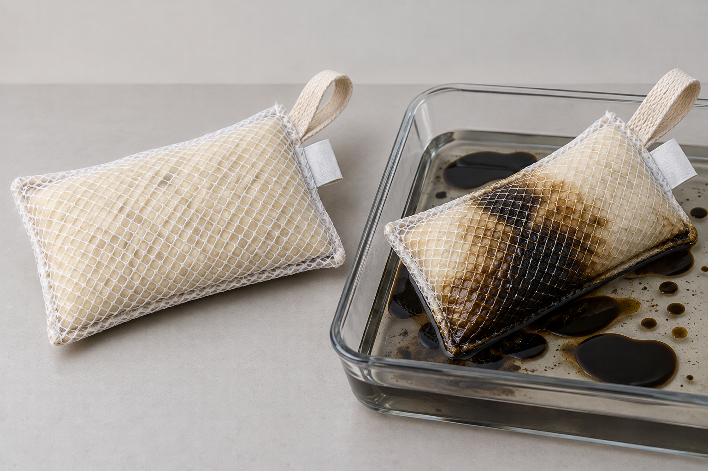

# Første skisse: ullabsorbent for kjølsvin

Dato: 2026-10-22. Status: **KI-generert konseptskisse, ikke laget eller testet produkt. Idéen er ikke låst.**

## Slik er første prøve tenkt

- Lys ull legges i en sydd nettingpose. Nettingen skal holde fibrene inne, men la olje nå ulla. Maskevidde og stoff må testes.
- En solid løkke gjør det mulig å løfte puten ved inspeksjon. Et enkelt merke kan knytte puten til dato og båt i serviceloggen.
- Ulla er synlig, slik at den som inspiserer kan se og fotografere oljespor. Mørk farge viser **kontakt med olje**, ikke en målt metningsgrad.
- Første forsøk skjer i en kontrollert beholder på land. Ingen elektronikk eller app trengs for å teste puten og inspeksjonsrutinen.

## Det skissen ikke viser som bevist

Vi vet ikke om nettingen holder på ullfibrene, om puten flyter, hvor mye olje og vann den tar opp, om løkken holder ved løfting, eller når den bør byttes. Bildet viser mørk motorolje for å forklare inspeksjonen; diesel kan se annerledes ut. Brukt prøve og eventuell olje leveres etter avtale med avfallsmottak. Se [undersøkelsen om metningsindikator](2026-10-22-oljeabsorbent-metningsindikator.md) for måleplan og kilder.

## Neste praktiske steg

Sy én prøve, noter ulltype og materialkostnad, og test i beholder med vann og egnet øvingsvæske under lærerens HMS-rutine. Fotografer fra samme vinkel før og etter. Sammenlign med et butikkprodukt. Ikke prøv den i en kundebåt før lekkasje, flyteevne, opptak og forsvarlig håndtering er avklart.
